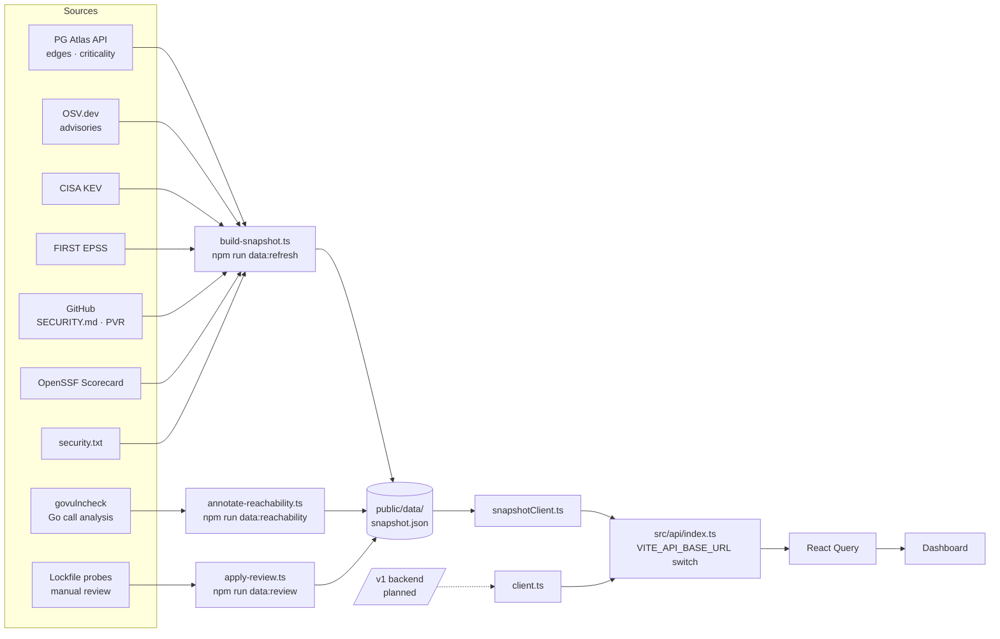

# Stellar PG Aegis

Security posture, vulnerability exposure and disclosure routing for Stellar public goods.

Aegis takes raw dependency data from [PG Atlas](https://pgatlas.xyz), verifies it against advisory
and reachability evidence, and answers three questions per project: *what are you exposed to, is
the vulnerable code actually called, and how do you report it privately.*

Live site: https://stellar-pg-aegis.netlify.app — spec: [`Specification.md`](Specification.md) —
dev notes: [`AGENTS.md`](AGENTS.md)

## What it does

- **Exposure** — matches dependency edges (verified SBOMs + inferred) against OSV advisories,
  ranked by a published priority score (severity · criticality · exploitability · exposure ·
  fix availability − confidence penalty).
- **Verification layers** on top of raw edges:
  - `govulncheck` call analysis for Go repos — `reachability: called / not-called / unflagged`
  - lockfile probes — committed `Cargo.lock`, `package-lock.json`, `pnpm-lock.yaml`, `bun.lock`,
    `uv.lock`, `composer.lock`, `requirements.txt` matched directly against OSV, recovering
    findings the edge graph never saw
  - advisory **kinds** — RustSec `unmaintained`/`unsound`/`notice`/`yanked` and MAL-\* malware
    are badged separately from real vulnerabilities
- **Disclosure routing** — ranked private channels per project: GitHub PVR, SECURITY.md
  contacts, security.txt, policy fallback.

## Quick start

```bash
npm install
npm run dev          # http://localhost:5173 — serves public/data/snapshot.json
```

The app runs entirely from a static snapshot; no backend is required.

## Pipeline



## Data sources

| Source | Provides | Auth | Cache | Status |
|---|---|---|---|---|
| PG Atlas API | projects, repos, dependency edges, dependents, criticality | none (`PG_ATLAS_API`) | 24h | live |
| OSV.dev | advisories by PURL+version (GHSA, RUSTSEC, PYSEC, GO, …) | none | per-vuln 30d | live |
| CISA KEV | exploited-in-the-wild CVEs | none | refresh-time | live |
| FIRST EPSS | exploit probability per CVE | none | refresh-time | live |
| GitHub API | SECURITY.md, PVR status, advisories, update tooling | `GITHUB_TOKEN` | 72h | live (capped by `GH_MAX_REPOS`) |
| OpenSSF Scorecard | repo health scores | none | 72h | live |
| security.txt | disclosure contacts on project domains | none | refresh-time | live |
| govulncheck | Go reachability (`called`/`not-called`/`unflagged`) | `go` toolchain | 30d per commit SHA | live (`GOVC=0` disables) |
| Lockfile probes | findings missed by the edge graph | none | n/a — runs on demand | live |
| Backend `/v1/*` | replaces the static snapshot | — | — | planned (spec §8) |

## Scripts

| Command | Purpose |
|---|---|
| `npm run dev` | Vite dev server |
| `npm run lint` / `npm run build` | eslint / typecheck + production build (run both before finishing a change) |
| `npm run data:refresh` | rebuild `public/data/snapshot.json` — needs `GITHUB_TOKEN`, `PG_ATLAS_API` |
| `npm run data:reachability` | govulncheck pass over the existing snapshot (`GOVC_REPOS=owner/name,…` to target) |
| `npm run data:review` | apply manual verdicts + lockfile probes to the snapshot |

## Conventions

- `null` means *not collected* — never fabricated. `unknown` severity means no computable CVSS,
  not a guess.
- `criticality_score` is a dependent count, `adoption_score` is 0–100 (PG Atlas semantics).
- React 19 + TypeScript + Vite 6 + Tailwind v4 + React Query + Recharts; primitives in
  `src/components/ui.tsx`; pages lazy-loaded.
- Deploy: Netlify (`netlify.toml`), `npm run build` → `dist/`.
