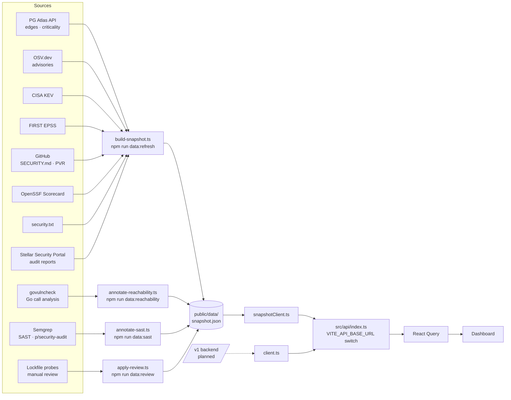

# Stellar PG Aegis

Security posture, vulnerability exposure and disclosure routing for Stellar public goods.

Aegis takes raw dependency data from [PG Atlas](https://pgatlas.xyz), verifies it against advisory
and reachability evidence, and answers three questions per project: *what are you exposed to, is
the vulnerable code actually called, and how do you report it privately.*

Live site: https://stellar-pg-aegis.netlify.app — spec: [`Specification.md`](Specification.md) —
dev notes: [`AGENTS.md`](AGENTS.md)

## What it does

- **Exposure** — matches dependency edges (verified SBOMs + inferred) against OSV advisories,
  ranked by a published priority score (severity · criticality · exploitability · exposure ·
  fix availability − confidence penalty).
- **Verification layers** on top of raw edges:
  - `govulncheck` call analysis for Go repos — `reachability: called / not-called / unflagged`
  - Semgrep SAST on WG-listed repos — `p/security-audit` rules matched at HEAD, kept in a
    separate `sast_findings` list (never priority-scored; severities are Semgrep's own)
  - lockfile probes — committed `Cargo.lock`, `package-lock.json`, `pnpm-lock.yaml`, `bun.lock`,
    `uv.lock`, `composer.lock`, `requirements.txt` matched directly against OSV, recovering
    findings the edge graph never saw
  - advisory **kinds** — RustSec `unmaintained`/`unsound`/`notice`/`yanked` and MAL-\* malware
    are badged separately from real vulnerabilities
- **Audit reports** — approved audits from the
  [Stellar Security Portal](https://stellarsecurityportal.com) matched to tracked projects via a
  curated map plus each protocol's own URL (never name matching). Shown per project, filterable
  with `?audited=1`, with WG-wide coverage on the overview.
- **Disclosure routing** — ranked private channels per project: GitHub PVR, SECURITY.md
  contacts, security.txt, policy fallback.

## Quick start

```bash
npm install
npm run dev          # http://localhost:5173 — serves public/data/snapshot.json
```

The app runs entirely from a static snapshot; no backend is required.

## Pipeline



## Data sources

| Source | Provides | Auth | Cache | Status |
|---|---|---|---|---|
| PG Atlas API | projects, repos, dependency edges, dependents, criticality | none (`PG_ATLAS_API`) | 24h | live |
| OSV.dev | advisories by PURL+version (GHSA, RUSTSEC, PYSEC, GO, …) | none | per-vuln 30d | live |
| CISA KEV | exploited-in-the-wild CVEs | none | refresh-time | live |
| FIRST EPSS | exploit probability per CVE | none | refresh-time | live |
| GitHub API | SECURITY.md, PVR status, advisories, update tooling | `GITHUB_TOKEN` | 72h | live (capped by `GH_MAX_REPOS`) |
| OpenSSF Scorecard | repo health scores | none | 72h | live |
| security.txt | disclosure contacts on project domains | none | refresh-time | live |
| Stellar Security Portal | approved audit reports per protocol (`SECURITY_PORTAL_API`) | none | 24h | live |
| govulncheck | Go reachability (`called`/`not-called`/`unflagged`) | `go` toolchain | 30d per commit SHA | live (`GOVC=0` disables) |
| Semgrep | SAST findings on WG-listed repos (`p/security-audit`) | `python3` + `pip` | 30d per commit SHA + version + ruleset | live (`SEMGREP=0` disables, `SEMGREP_MAX_REPOS` caps) |
| Lockfile probes | findings missed by the edge graph | none | n/a — runs on demand | live |
| Backend `/v1/*` | replaces the static snapshot | — | — | planned (spec §8) |

## Scripts

| Command | Purpose |
|---|---|
| `npm run dev` | Vite dev server |
| `npm run lint` / `npm run build` | eslint / typecheck + production build (run both before finishing a change) |
| `npm run data:refresh` | rebuild `public/data/snapshot.json` — needs `GITHUB_TOKEN`, `PG_ATLAS_API` |
| `npm run data:reachability` | govulncheck pass over the existing snapshot (`GOVC_REPOS=owner/name,…` to target) |
| `npm run data:sast` | Semgrep pass over the existing snapshot (`SEMGREP_REPOS=owner/name,…` to target) |
| `npm run data:review` | apply manual verdicts + lockfile probes to the snapshot |
| `npm run data:diff` | `node scripts/diff-snapshot.ts <old.json> <new.json>` — markdown report of finding changes (used by the refresh workflow) |

## Use in your repo

Maintainers can drop Aegis's vulnerability scan into their own CI. It runs
[osv-scanner](https://github.com/google/osv-scanner) over committed lockfiles (PRs flag only
*newly introduced* vulnerabilities) plus `govulncheck` reachable-vulnerability analysis on
Go modules plus Semgrep SAST (`p/security-audit` by default), and uploads results to
Security → Code scanning.

```yaml
# .github/workflows/aegis-scan.yml
name: Vulnerability scan
on:
  pull_request:
  schedule: [{ cron: '30 5 * * 1' }]

permissions: {}

jobs:
  scan:
    uses: ogtechnologiesteam/stellar-pg-aegis-frontend/.github/workflows/aegis-scan.yml@main
    permissions:
      contents: read
      actions: read
      security-events: write
```

Inputs: `fail-on-vuln` (default `true`), `govulncheck` (default `true`),
`semgrep` (default `true`), `semgrep-config` (default `p/security-audit`),
`sarif-upload` (default `true`), `scan-args` (forwarded to osv-scanner).
Ignore advisories with an `osv-scanner.toml` `[[IgnoredVulns]]` block at the repo root —
see this repo's `osv-scanner.toml` for an example.

## Workflows in this repo

| Workflow | Trigger | Purpose |
|---|---|---|
| `vuln-scan.yml` | PRs + weekly | dogfoods `aegis-scan.yml` on this repo's own lockfiles |
| `snapshot-refresh.yml` | nightly + dispatch | rebuilds `public/data/snapshot.json`, writes the finding diff to the job summary, commits the result. Set `AEGIS_GH_TOKEN` (PAT) if the built-in token rate-limits GitHub enrichment or if branch protection blocks the snapshot commit |

## Conventions

- `null` means *not collected* — never fabricated. `unknown` severity means no computable CVSS,
  not a guess.
- `criticality_score` is a dependent count, `adoption_score` is 0–100 (PG Atlas semantics).
- React 19 + TypeScript + Vite 6 + Tailwind v4 + React Query + Recharts; primitives in
  `src/components/ui.tsx`; pages lazy-loaded.
- Deploy: Netlify (`netlify.toml`), `npm run build` → `dist/`.
